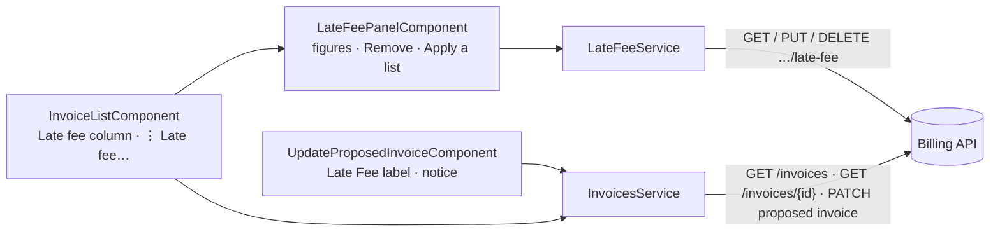

## Changelog

| Version | Date | Summary | Plan |
|---------|------|---------|------|
| v1 | 2026-10-12 | **Initial spec: an invoice's late fee, read, applied and removed from the invoice list, and late fee lines on Update Invoice.** Built on Billing spec `16-late-fee-consumer.md` **v13** and its routes: `GET`, `PUT` and `DELETE /api/v1/invoices/{id}/late-fee`, the `lateFeeAmount` on each `GET /api/v1/invoices` item, and the `lateFee` block on `GET /api/v1/invoices/{id}` (D31). The invoice list gains a **Late fee** column and a **Late fee…** menu item, which opens a side panel with the figures, **Remove late fee**, and a form that applies a late fee list exactly as the late fee event does (D28). Update Invoice labels a late fee line "Late Fee" and says what editing it, or moving the due date, does to further late fees. **No backend change.** | [2026-10-12T1500-07-late-fee-ui](../../plans/rent-agreements/2026-10-12T1500-07-late-fee-ui.md) |

## Overview

A tenant who pays late is charged a late fee. In Billing the late fee service works out the fee and
Billing applies it to the invoice, as legacy Merlin does (backend spec `16-late-fee-consumer.md`). This
screen set lets a property owner, or a tester, **see** an invoice's late fee, **remove** it, and **apply**
a late fee list by hand, which is how the late fee path is exercised before the late fee service
publishes its event. It also makes the existing **Update Invoice** page honest about late fee lines:
editing one stops further late fees, and so can moving the due date. Stakeholders: property owners (read,
remove, edit), testers (apply), and the Billing team, for whom this UI is the API's test harness.

## System Architecture & Tech Stack



| Concern | Choice |
|---------|--------|
| Framework | Angular 19, standalone components, signals, reactive forms (as every screen here) |
| HTTP | `HttpClient`; the scope headers come from the existing `scopeHeadersInterceptor`, so no call names an owner |
| New | `late-fee.models.ts`, `late-fee.service.ts`, `late-fee-panel.component.{ts,html,scss}` under `src/app/invoices/` |
| Changed | `invoice-list.component.*`, `invoice.models.ts`, `update-proposed-invoice.component.*` |
| Styles | The shared `.panel-overlay`, `.close-btn`, `.link-btn` and `.banner` from `src/styles.scss`; the 6 kB per-component style budget holds |
| Tests | Jasmine/Karma specs beside each file (`ng test`); a row in `docs/ui-automation-test-matrix.md` |

**Constraints**
- **No backend change.** Every figure, rule and refusal is the backend's; the screen shows it.
- **A test harness, not a product screen** (this repository's standing rule). Texts follow backend spec 16,
  not product copy, and the apply form exists for testing (D28).
- **The figures are eventually consistent.** The two marks are read from the proposal and change at once;
  the amounts and lines are the issued invoice's and change only after the reconcile runs. The panel says
  so and re-reads (FR 12).
- **The screen refuses before the server does** (plan `2026-09-11T1200`): the apply form checks the same
  figure rules the backend does (backend BR-37 to BR-39), and still renders the server's refusal verbatim.

## Database Schema

**No persistence.** The panel and the forms hold their state in component signals for as long as they are
open. Nothing is written to `localStorage` or `sessionStorage`.

## Core Features & User Flows

### Functional Requirements

| # | Requirement | Backend source |
|---|-------------|----------------|
| FR 1 | The invoice list shall show a **Late fee** column with each item's `lateFeeAmount`, formatted as money, and `—` when it is 0 | D31 |
| FR 2 | Each row's ⋮ menu shall offer **Late fee…** for every invoice, voided and deleted included | Flow 2 (answers for any invoice the owner sees) |
| FR 3 | **Late fee…** shall open a side panel that reads `GET …/late-fee` and shows the invoice type, due date, invoice amount, paid amount, late fee amount, paid part, what removal takes off, the **Removed** and **Edited** marks, and the late fee lines (description, quantity, rate, amount) | Flow 2; BR-11 |
| FR 4 | An invoice with no late fee shall read zeros and "No late fee lines", not an error | Flow 2 |
| FR 5 | The panel shall offer **Remove late fee** and **Apply a late fee list** only while the invoice is not `voided` or `deleted`, as the list offers Delete and Void (spec `04` FR 21) | BR-15; BR-05 |
| FR 6 | **Remove late fee** shall ask an inline confirmation naming what it does: the unpaid part (`remainingLateFeeAmount`) is removed, the paid part (`paidLateFeeAmount`) stays, and no further late fee is applied | BR-10 to BR-13 |
| FR 7 | A confirmed removal shall call `DELETE …/late-fee`; on `204` the panel re-reads (FR 12) and the list re-runs its current search | Flow 3 |
| FR 8 | **Apply a late fee list** shall show a form of a calculation time and zero or more lines, each a key, a description, a whole quantity, a rate and the amount, which the form works out as quantity × rate and does not let the user type | D28; BR-37, BR-38 |
| FR 9 | The calculation time shall start as now, in UTC, as ISO 8601, and stay editable, so a tester can send an older calculation | BR-04 |
| FR 10 | The form shall refuse, before sending: an empty or over-100-character key, two lines with one key (ignoring surrounding spaces), an empty or over-200-character description, a quantity that is not a whole number from 1 to 9,999,999,999, a rate that is not greater than 0 with at most 2 decimals and at most 999,999,999,999.99, and an amount over that limit | Inbound contract; A10; BR-37 to BR-39 |
| FR 11 | A sent list shall call `PUT …/late-fee` and show the answer: **applied**, with "lines changed" or "no line changed", or **skipped**, with the skip reason in words; on applied, the panel re-reads (FR 12) and the list re-runs its search | A13 |
| FR 12 | After a removal or an applied list that changed a line, the panel shall re-read `GET …/late-fee` once a second, at most ten times, until the late fee amount reads what the change leaves: after a removal, the paid part read before it; after an applied list, the list's total. It then stops; when it never did, it says "The invoice has not caught up yet" with a **Refresh** button. A removal that leaves the amount as it was (nothing unpaid) needs no wait | Constraints |
| FR 13 | Every refusal shall render the backend's RFC 9457 `detail` verbatim in the panel, with its status (`400`, `404`, `409`, `422`) | spec `04` FR 25 |
| FR 14 | On Update Invoice, a line whose `itemType` is `LateFeeCharge` shall be labelled **Late Fee**, whatever catalog id it carries | D32 |
| FR 15 | Update Invoice shall show a notice when the invoice carries a late fee line: changing a late fee line's quantity, rate or amount, or removing it, stops further late fees; moving the due date to today or later removes the unpaid late fee; moving it earlier stops further late fees | BR-19, BR-22, BR-23 |
| FR 16 | Update Invoice shall keep sending a late fee line's `lineId` and `lineItemId` as it does for every line; no line is added as `LateFeeCharge`, which the catalog never offers | BR-18, BR-21, BR-40 |
| FR 17 | `invoice.models.ts` shall carry `lateFeeAmount` on a list item and the `lateFee` block on the detail, both optional, so an older API answers as before | D31 |

### Flow 1 — See an invoice's late fee

1. The user opens `/invoices`; each row shows its **Late fee** (FR 1).
2. The user opens a row's ⋮ menu and picks **Late fee…** (FR 2).
3. The panel reads `GET …/late-fee` and shows the figures, the marks and the lines (FR 3, FR 4).

### Flow 2 — Remove the late fee

1. In the panel the user picks **Remove late fee** (FR 5).
2. The inline confirmation says what goes and what stays (FR 6); the user confirms.
3. `DELETE …/late-fee` answers `204`; the panel shows **Removed** at once and re-reads the figures until
   the invoice catches up (FR 7, FR 12). The list refreshes.

### Flow 3 — Apply a late fee list (testing)

1. In the panel the user picks **Apply a late fee list** (FR 5).
2. The user sets the calculation time, adds lines, and sees each amount worked out (FR 8, FR 9).
3. The form refuses what the backend would refuse (FR 10); otherwise **Send** calls `PUT …/late-fee`.
4. The panel shows **applied** or **skipped** with its reason (FR 11), and re-reads (FR 12).

### Flow 4 — Edit an invoice that carries a late fee

1. The user opens Update Invoice for the invoice.
2. The late fee line reads **Late Fee** (FR 14), and the notice explains the rules (FR 15).
3. The user edits and saves as today (FR 16); the backend decides the marks.

### Error scenarios

| Situation | What the user sees |
|-----------|--------------------|
| `GET …/late-fee` answers `404 invoice.not_found` | The panel's banner with the `detail`; no figures |
| `DELETE` answers `422 late_fee.invoice_withdrawn` or `422 late_fee.only_late_fees_remain` | The banner with the `detail`; nothing changes |
| `PUT` answers `400 late_fee.invalid_event` | The banner with the `detail`, which names the broken rule |
| `PUT` or `DELETE` answers `409 rent_agreement.concurrency_conflict` | The banner with the `detail`; the user can try again |
| `PUT` answers `200` skipped | Not an error: "Skipped — {reason in words}" (FR 11) |
| The figures have not caught up after ten reads | "The invoice has not caught up yet" and **Refresh** (FR 12) |

Skip reasons in words: `unknown_invoice` "no such invoice for this owner"; `invoice_withdrawn` "the invoice is
voided or deleted"; `rent_agreement_not_found` "its rent agreement was not found"; `rent_agreement_archived`
"its rent agreement is archived"; `proposal_ended` "its billing plan entry has ended"; `deposit_invoice` "a
deposit invoice takes no late fee"; `late_fee_removed` "late fees are stopped on this invoice"; `paid_in_full`
"the invoice is paid in full"; `older_calculation` "a newer calculation was already applied".

## API Endpoints & Server Operations

### Endpoints consumed

| Method and route | Used by | Answers |
|------------------|---------|---------|
| `GET /api/v1/invoices` | List (FR 1) | Each item's `lateFeeAmount` |
| `GET /api/v1/invoices/{id}/late-fee` | Panel (FR 3, FR 12) | `200 LateFeeSummaryResponse`; `404` |
| `PUT /api/v1/invoices/{id}/late-fee` | Panel (FR 11) | `200 ApplyLateFeesResponse`; `400`; `409` |
| `DELETE /api/v1/invoices/{id}/late-fee` | Panel (FR 7) | `204`; `404`; `409`; `422` |
| `GET /api/v1/invoices/{id}` | Update Invoice (unchanged), models (FR 17) | The `lateFee` block |

### Wire models (`late-fee.models.ts`)

```ts
export interface LateFeeLineResponse { lineId: string; description: string; quantity: number; rate: number; amount: number; }

export interface LateFeeSummaryResponse {
  invoiceId: string; dueDate: string; invoiceType: string;
  invoiceAmount: number; paidAmount: number;
  lateFeeAmount: number; paidLateFeeAmount: number; remainingLateFeeAmount: number;
  isLateFeeRemoved: boolean; isLateFeeEdited: boolean;
  lines: LateFeeLineResponse[];
}

export interface LateFeeLineInput { lineKey: string; description: string; quantity: number; rate: number; amount: number; }
export interface ApplyLateFeesRequest { calculatedAtUtc: string; lines: LateFeeLineInput[]; }
export interface ApplyLateFeesResponse { outcome: 'applied' | 'skipped'; skipReason: string | null; linesChanged: boolean; }

/** The detail's block (D31), on `InvoiceDetailResponse.lateFee`. */
export interface InvoiceLateFeeResponse {
  lateFeeAmount: number; paidLateFeeAmount: number; remainingLateFeeAmount: number;
  isLateFeeRemoved: boolean; isLateFeeEdited: boolean;
}
```

`InvoiceSummaryResponse` gains `lateFeeAmount?: number`; `InvoiceDetailResponse` gains
`lateFee?: InvoiceLateFeeResponse`.

### `LateFeeService`

| Method | Call |
|--------|------|
| `get(invoiceId)` | `GET /api/v1/invoices/{invoiceId}/late-fee` |
| `apply(invoiceId, request)` | `PUT /api/v1/invoices/{invoiceId}/late-fee` |
| `remove(invoiceId)` | `DELETE /api/v1/invoices/{invoiceId}/late-fee` |

## Automated & Background Systems

**None**, other than the panel's bounded re-read after a change (FR 12): at most ten reads, a second
apart, stopped when the panel closes.

## Definition of Done

1. The list shows each item's late fee, and `—` for 0 (FR 1).
2. ⋮ offers **Late fee…** on an open, a voided and a deleted invoice (FR 2).
3. The panel shows every figure, both marks and the lines from a `GET …/late-fee` answer; a zero answer reads
   "No late fee lines" (FR 3, FR 4).
4. **Remove** and **Apply** are absent for a voided and for a deleted invoice (FR 5).
5. The removal confirmation names the unpaid and the paid amounts; confirming calls `DELETE` once; `204`
   re-reads the panel and re-runs the list's search (FR 6, FR 7).
6. The apply form works out each amount as quantity × rate and sends it; the user cannot type it (FR 8).
7. The calculation time starts as now in ISO 8601 UTC and can be edited (FR 9).
8. Each FR 10 rule refuses before any request: a blank key, a 101-character key, a duplicated key ignoring
   spaces, a blank and a 201-character description, a quantity of `1.5`, `0` and `10000000000`, a rate of `0`,
   `10.001` and `1000000000000`. One spec per rule.
9. An applied answer shows "applied" and whether a line changed; a skipped answer shows the reason in words,
   one spec per skip reason (FR 11).
10. After a change, the panel re-reads until the late fee reads what the change leaves (the paid part after a
    removal, the list's total after an applied list), at most ten times, and then shows **Refresh**; a removal
    with nothing unpaid does not wait; closing the panel stops the reads (FR 12).
11. A `400`, `404`, `409` and `422` each render their `detail` in the panel (FR 13).
12. Update Invoice labels a `LateFeeCharge` line **Late Fee** and shows the notice only when a late fee line is
    present (FR 14, FR 15).
13. A save from Update Invoice sends a late fee line's `lineId` and `lineItemId` unchanged (FR 16).
14. An answer without `lateFeeAmount` or `lateFee` (an older API) renders as before (FR 17).
15. `ng test` and `ng build` pass, with no new budget warning.
16. Manually against a running Billing API: apply a list, see it reach the panel, remove it, and see the paid
    part stay — recorded in the plan with the date.

### Out of Scope

- An invoice detail page: the panel is where the late fee is read.
- Product wording and visual design (this UI is the API's test harness).
- The late fee service, its settings, and anything that decides lateness (backend D1, D13).
- Showing the publisher's `LineKey` of a live line: `GET …/late-fee` does not return it, so the apply form
  starts empty rather than pre-filled.
