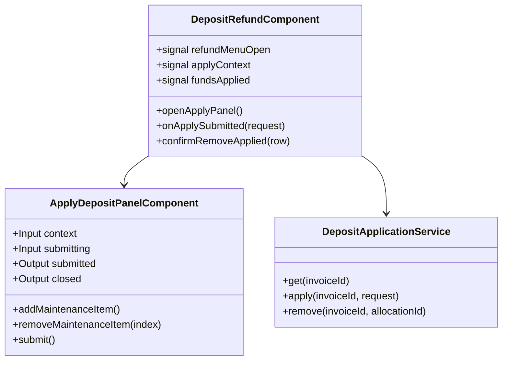

## Changelog

| Version | Date | Summary | Plan |
|---------|------|---------|------|
| v1 | 2026-10-12 | **Initial spec: Apply It — apply a fully paid deposit to the lease's open invoices and to new maintenance charges, and remove an applied amount.** The client half of backend `16-deposit-application.md` v1. *Refund Deposit* on the Deposit Refund page becomes a menu of **Return It** (the existing *Return Deposit* panel, unchanged) and **Apply It** (the new *Apply Deposit* panel, laid out as the owner app's screen). The page gains a *Funds Applied to Other Invoices* block with a row-level *Remove*. Spec `09-deposit-refund-ui.md` v3 records the menu. | [2026-10-12T1200-10-deposit-application-ui](../../plans/rent-agreements/2026-10-12T1200-10-deposit-application-ui.md) |

## Overview

`ApplyDepositPanelComponent` (`src/app/invoices/apply-deposit-panel.component.ts`) is the *Apply
Deposit* side panel; `DepositApplicationService` (`src/app/invoices/deposit-application.service.ts`) is
the HTTP client for the three endpoints of backend spec `16-deposit-application.md` v1. Both are opened
from `DepositRefundComponent` (spec `09-deposit-refund-ui.md`), the page at `/invoices/deposit-refund`.

**Every figure and every gate is the server's.** What the deposit still holds (`available`), which
invoices may receive it and how much each still owes (`balanceDue`) are derived by Billing on each
request from its own write model and a live Finance read (backend BR-03, BR-05, BR-06). The panel adds up
the owner's own entries and holds them against those figures, with the server's sentences, so a mistake
is caught before a request is sent — and the server checks everything again before anything moves.

## Business Scope

At move-out an owner may keep some of a tenant's deposit to settle rent that is still unpaid, or to pay
for repairs. The owner app has done this through merlin as *Apply It*; a deposit invoice Billing raised
had no way to. Success: open a fully paid deposit invoice, choose *Refund Deposit → Apply It*, put $60
on an unpaid rent invoice and $40 on "Carpet cleaning", press *Apply Funds*, and see both rows under
*Funds Applied to Other Invoices* — the maintenance one reading *Pending* until its invoice is raised —
with *Amount Applied To Open Invoices* at $100; then remove the $60 again.

## Functional Requirements

1. **Refund Deposit is a menu.** On a fully paid deposit invoice, *Refund Deposit* shall open a menu of
   two cards, as the owner app shows them: **Return It** — *"Mark the invoice as returned and send the
   funds back to the tenant online or offline."* — and **Apply It** — *"Use the deposit funds to close
   unpaid or overdue invoices for this group of Tenants."* Both are disabled when `canRefundDeposit` is
   false. When the deposit is fully refunded the button itself stays disabled with its tooltip (spec 09
   FR 4), so the menu cannot open.
2. **Return It** shall open the existing *Return Deposit* panel, unchanged (spec 09 FR 5–14).
3. **Apply It** shall read `GET /api/v1/invoices/{id}/deposit-application` and open the *Apply Deposit*
   panel once it answers. A failed read shall be shown as a page banner with the Problem Details
   `detail` and code, and no panel. If the answer says `canApplyDeposit: false` the panel shall not open
   and the page shall say *"Deposit has already been refunded."*
4. The panel shall show a summary card — *Invoice {number}*, *Available to Apply* (`available`) and a
   *PAID* stamp — then the heading **Apply** with the owner app's sentence: *"You can apply the deposit
   amount to outstanding invoices or to move-out maintenance / repairs. Below is a list of invoices
   associated with this lease that remain unpaid."*
5. **Maintenance.** A table *Maintenance · Description · Amount · Action* with one empty row to start.
   *Add Another Maintenance Item* adds a row; the bin removes one. A row with no description and no
   amount is not sent. A row with an amount needs a description (≤ 250 characters), and a row with a
   description needs an amount above zero.
6. **Open invoices.** A table *Invoice ID · Type · Due Date · Balance Due · Amount to Apply*, one row per
   `openInvoices[]` entry in the order served, the invoice number as the id. A row left at 0 is not
   sent. When there are none the table says *"No unpaid invoices on this lease."* — maintenance can still
   be applied.
7. The panel shall show running totals: *Total to Apply* = Σ amounts, and *Remaining After Apply* =
   `available` − total, red when negative.
8. **Checks, in the server's words** (backend BR-08 – BR-10), shown from the first *Apply Funds* press
   and live afterwards:
   - every amount is 0 or more with at most two decimals — *"Each allocation amount must be zero or
     more, with at most two decimals."* / *"Each maintenance amount must be above zero, with at most two
     decimals."*;
   - an amount above that invoice's `balanceDue` — *"The amount to apply is more than the invoice's
     balance due."* (equal is allowed);
   - a total above `available` — *"The amount to apply is more than the deposit still holds."*;
   - nothing above zero — *"At least one amount above zero must be applied."*;
   - a maintenance description missing or too long, as FR 5.
9. **Apply Funds** shall emit `{ applicationId, allocations[{ invoiceId, amount }], maintenanceItems[{
   description, amount }] }`. `applicationId` is generated **once per opening of the panel**, so pressing
   again after a lost answer is the same submission and the server answers it as a replay (backend
   BR-13) rather than applying twice.
10. The page shall post it once; a second press while it is in flight is ignored. On `201` or `200` it
    shall close the panel, say *"Deposit has been applied successfully."*, and re-read the page. A
    refusal shall be shown above the still-open panel with the server's `detail` and code, and what was
    typed is kept.
11. **Funds Applied to Other Invoices.** When `totals.totalApplied` is above 0, the page shall read the
    application context and list its `fundsApplied[]`: *Applied To* (the invoice number, or *Pending*
    for a maintenance invoice not raised yet), *Applied On*, *Amount*, and a *Remove* action on a row
    whose `canRemove` is true. *Remove* asks to confirm, then calls `DELETE
    /api/v1/invoices/{id}/deposit-applications/{allocationId}` and re-reads the page. A refusal —
    `409 maintenance_invoice_pending`, `422 maintenance_invoice_paid` — is a page banner.
12. Every call rides `scopeHeadersInterceptor`; another owner's invoice answers `404 invoice.not_found`.

## Constraints

- **Requires backend `16-deposit-application.md` v1** (Billing `Piyush/deposit-application`). Against
  an older Billing the three routes answer `404`, which this screen renders as an ordinary failure.
- **Ids travel as plain GUID strings and dates as `yyyy-MM-dd`**, as Billing serializes its typed ids and
  `DateOnly`.
- **No retry, anywhere.** The panel's `applicationId` makes a person pressing again safe; the client
  itself never re-sends.
- **Per-component style budget (6 kB warning).** The panel keeps its own styles and reuses the global
  `.banner`, `.panel-overlay` and `.close-btn`.

## Contract

### API Endpoints consumed

| Method | Route | Used for | Notable responses |
|--------|-------|----------|-------------------|
| `GET` | `/api/v1/invoices/{id}/deposit-application` | the panel's context and *Funds Applied* | `200` `DepositApplicationContextResponse`; `404` `invoice.not_found`; `502` `deposit_application.payment_service_unavailable` |
| `POST` | `/api/v1/invoices/{id}/deposit-applications` | apply the deposit | `201` new · `200` replay, `ApplyDepositResponse`; `400` `create_validation_failed`; `404` `invoice.not_found`; `409` `rent_agreement.concurrency_conflict`; `422` `not_a_deposit_invoice` · `deposit_not_fully_paid` · `nothing_available` · `exceeds_available_deposit` · `exceeds_invoice_balance` · `invalid_target` · `lease_not_active`; `502` `payment_service_unavailable` |
| `DELETE` | `/api/v1/invoices/{id}/deposit-applications/{allocationId}` | remove an applied amount | `204`; `404` `allocation_not_found`; `409` `maintenance_invoice_pending`; `422` `maintenance_invoice_paid` |

### Input / Output models

`DepositApplicationContextResponse`: `invoiceId`, `invoiceNumber`, `canApplyDeposit`, `depositAmount`,
`totalReturned`, `totalApplied`, `available`, `openInvoices[]`, `fundsApplied[]`.

| Type | Fields |
|------|--------|
| `openInvoices[]` | `invoiceId`, `invoiceNumber`, `invoiceType`, `dueDate`, `total`, `balanceDue` |
| `fundsApplied[]` | `allocationId`, `appliedToInvoiceId \| null`, `appliedToInvoiceNumber \| null`, `appliedOn`, `amount`, `isMaintenance`, `canRemove` |
| `ApplyDepositRequest` | `applicationId`, `allocations[]` (`invoiceId`, `amount`), `maintenanceItems[]` (`description`, `amount`) |
| `ApplyDepositResponse` | `applicationId`, `allocations[]` (`allocationId`, `invoiceId \| null`, `invoiceNumber \| null`, `additionalChargeId \| null`, `amount`), `isReplay` |

### Class Diagram

## Out of Scope

- The owner app itself — this harness drives the Billing endpoints the owner app will call.
- The panel header's bank account (the owner app shows one); Billing's context does not carry it.
- Editing an applied amount — remove it and apply again, as backend D6 settles.
