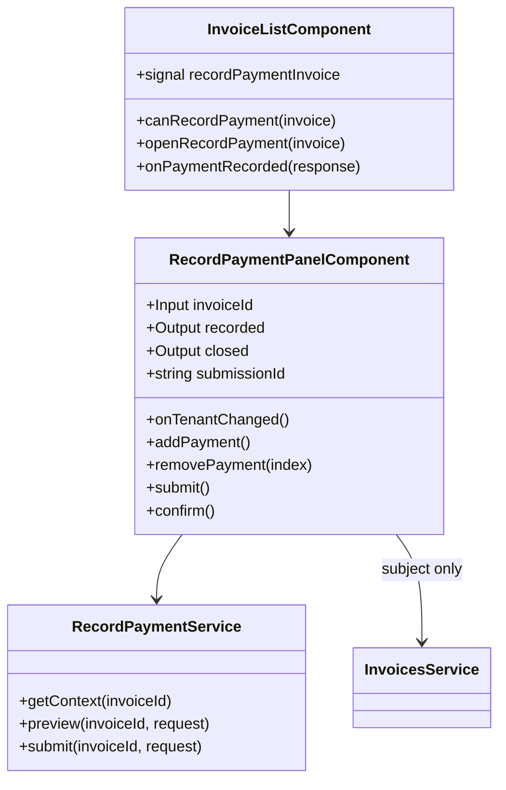

## Changelog

| Version | Date | Author | Summary | Plan |
|---------|------|--------|---------|------|
| v1 | 2026-10-13 | Piyush Raj | **Initial spec: Record Payment — record a tenant's offline payment (Cash, Check or Money Order) on a Billing invoice, with the excess applied to the tenant's other open invoices.** The client half of Billing spec `18-record-payment.md` **v2** (`docs/specs/record-payment/18-record-payment.md` in `innago-billing`, branch `Piyush/record-payment-in-billing`), which moved Record Payment into Billing for `INV-…` invoices: `GET /invoices/{id}/offline-payment` for the panel's context, `POST …/offline-payments/preview` for the allocation preview, and `POST …/offline-payments` to submit once, keyed by a client `submissionId` (BR-27 – BR-41). The panel is laid out as the owner app's *RECORD PAYMENT* side panel (screenshots of QA invoice 9559389, 2026-10-13). Reached from a new **Record Payment…** item on the Invoices list's row menu, shown on rows that still owe money (spec [`04-invoice-list-ui.md`](04-invoice-list-ui.md) v11, FR 28). | [2026-10-13T1800-11-record-payment-ui](../../plans/rent-agreements/2026-10-13T1800-11-record-payment-ui.md) |

## Overview

`RecordPaymentPanelComponent` (`src/app/invoices/record-payment-panel.component.ts`) is the *Record
Payment* side panel; `RecordPaymentService` (`src/app/invoices/record-payment.service.ts`) is the HTTP
client for the three endpoints of Billing spec `18-record-payment.md` v2. The panel is opened from the
Invoices list's row menu (spec `04-invoice-list-ui.md` FR 28), the way the late fee panel is (spec
`07-late-fee-ui.md` FR 2): it takes the invoice id, reads its own context, and tells the list when a
payment was submitted so the list can re-read.

**Every figure and every gate is the server's.** What the invoice still takes (`payable`), who may pay
it, each tenant's suggested amount, how an excess divides across the agreement's other open invoices and
the most the tenant can pay (`maxPayable`) are derived by Billing on each request from its own model and a
live Finance read (backend BR-29 – BR-36). The panel checks only the fields themselves before anything is
sent, and shows the server's allocation and its sentence when the total is too high.

**Submitted means queued.** A `202` says Finance has queued the payment, not that Billing's figures moved
(backend Flow 3). The list re-reads straight away and says so; the payment shows on the invoice once
Finance's snapshot reaches Billing (backend spec 09).

## Business Scope

A tenant pays rent in cash, by check or by money order, and the owner records it so the invoice settles.
Billing invoices (`INV-…`) have no row in the monolith, so the owner app's merlin-backed Record Payment
cannot serve them. Success, on the backend's worked example: open *Record Payment…* on
`INV-102026-000101` (total $190.00, $5.00 paid), choose Geetika Shukla — the amount reads $90.00 — choose
Cash, type $400.00, see *"You entered an amount greater than the balance due. The excess amount of $215.00
will be applied on the following invoices."* with `…102` taking $200.00 and `…103` $15.00, press
*Submit*, confirm, and see the list re-read with *"Payment submitted."*.

## Functional Requirements

1. **Opening.** The panel shall read `GET /api/v1/invoices/{id}/offline-payment` when it opens and show
   *"Loading…"* until it answers. A refusal (`404 invoice.not_found`, `422 record_payment.not_payable`,
   `422 record_payment.nothing_to_pay`, `502 record_payment.payment_service_unavailable`) shall be shown
   in the panel as FR 16 describes, with no form.
2. **Invoice Summary.** Under the title **RECORD PAYMENT**, a grey **INVOICE SUMMARY** block shall show a
   table *ID · SUBJECT · DUE · PAID · BALANCE*: `invoiceNumber`, the invoice's subject, `total`, `paid`
   and `payable`. The subject is the first line's description from `GET /api/v1/invoices/{id}` (the owner
   app's *"first line item's description"*), read alongside the context; while it is unknown, or if that
   read fails, the cell reads *—* and nothing else changes.
3. **Tenant.** Line 1 shall offer a *Tenant* select of `tenants[]` by `name` (the app's stand-in name when
   Billing has none), with *"Select Tenant"* until one is chosen. An invoice with exactly one tenant
   starts with that tenant chosen. Choosing a tenant shall reset the panel to **one line** and set its
   *Amount Paid* to that tenant's `suggestedAmount`; any preview is cleared.
4. **Payment Method.** Shown once a tenant is chosen: a select of `methods[]` as *Cash*, *Check* and
   *Money Order*, with *"Select Payment Method"* until one is chosen.
5. **Number.** *Check* shows *Check Number*, *Money Order* shows *Money Order Number*; *Cash* shows
   neither. The number is optional, at most 24 characters (backend D6); a blank number is not sent, and
   switching to Cash clears it.
6. **Submission Date\*** and **Amount Paid\*** are shown once a tenant and a method are chosen. The date
   defaults to today, is picked with the app's Material datepicker, and may not be in the future
   (backend D5); the picker offers no later day. The amount defaults as FR 3 says.
7. **Add Additional Payment.** *+ Add Additional Payment* shall add a line whose *Tenant* is line 1's,
   shown **disabled**; its *Payment Method*, number and amount start empty and its date is line 1's. It is
   enabled only while the last line has a method and an amount above zero (the owner app's rule), and
   never while the total exceeds `maxPayable` (FR 11). There is no limit on the number of lines (D10).
8. **Remove.** Every line after the first shall carry a red *Remove* link that drops it.
9. **Field checks.** From the first *Submit* press, each field shall show its problem under it, and
   *Submit* sends nothing while any remains: *"Required"* (tenant, method, date, amount); *"Should be
   greater than $0.00"*; *"Only number allowed with 2 decimal places."*; *"The Submission Date cannot be
   in the future."*; *"At most 24 characters."* (number). These are backend BR-33's rules, so a request
   the panel sends is one the server accepts on its fields.
10. **Preview.** Whenever every line passes FR 9, a change to any method, number, date or amount shall
    post `POST …/offline-payments/preview` with `{ tenantId, payments[] }`, **350 ms after the last
    change**; a newer change supersedes a preview still in flight. When the answer has `excess` > 0 and
    `exceedsPayable` false, a blue box shall say *"You entered an amount greater than the balance due.
    The excess amount of {excess} will be applied on the following invoices."* above a table *ID · DUE ON
    · AMOUNT · PAID · BALANCE* — one row per `allocations[]` entry **other than this invoice** (the owner
    app does not repeat the current invoice): `invoiceNumber`, `dueDate` as *MMM d, y*, `payableBefore`,
    `applied`, `payableAfter`. Lines that no longer pass FR 9 clear the preview.
11. **Exceeds.** When the answer has `exceedsPayable` true, the panel shall show its `message` (BR-36:
    *"There are no other unpaid or future invoices, therefore, you cannot enter an amount greater than
    {maxPayable}."*) in red under the lines, and disable *Submit* and *+ Add Additional Payment* until a
    later preview says otherwise.
12. *Submit* is disabled while a preview is in flight, while one is waiting out its 350 ms, and while a
    submission is in flight. A failed preview shall be shown under the lines (FR 16) and does not block
    *Submit*: the server checks everything again on submission.
13. **Confirmation.** *Submit* with every check passing shall show the owner app's confirmation —
    *"Please review the payment information before submitting (particularly the Amount field). If all the
    information is correct, confirm your submission."* — with **Yes** and **No**. *No* returns to the
    panel with nothing sent.
14. **Submission.** *Yes* shall post `POST …/offline-payments` with `{ submissionId, tenantId,
    payments[{ method, amount, paidOn, checkNumber? }] }`. `submissionId` comes from
    `crypto.randomUUID()` **once per opening of the panel** and is sent unchanged on every later press, so
    a retry after a lost answer is the same submission and is recorded once (backend D9, BR-39). Lines are
    sent in the order shown; `paidOn` is `yyyy-MM-dd` in the browser's local date.
15. **Accepted.** On `202` the panel shall close, the list shall say *"Payment submitted on {invoice
    number}. It will appear on the invoice once the payment service records it."*, and the list shall
    re-read.
16. **Refusals.** A refusal shall be shown in the panel as a red banner with a readable sentence and the
    Problem Details code beside it (as the Deposit Refund page shows them, spec 09 FR 13). What was typed
    is kept. The sentence, by code:
    - `record_payment.validation_failed`, `record_payment.exceeds_payable`,
      `record_payment.rejected_by_payment_service` — the server's `detail`, verbatim (it names the field,
      the maximum, or Finance's own reason);
    - `invoice.not_found` — *"This invoice was not found. It may have been deleted, or it belongs to
      another owner."*;
    - `record_payment.not_payable` — *"A payment cannot be recorded on this invoice: it is voided,
      deleted, or not on a rent agreement."*;
    - `record_payment.nothing_to_pay` — *"Nothing is left to pay on this invoice."*;
    - `record_payment.tenant_not_on_invoice` — *"The selected tenant is not on this invoice."*;
    - `record_payment.payment_service_unavailable` — *"What has been paid could not be read from the
      payment service. Try again in a moment."*;
    - `Request.Malformed` — *"The request could not be read. Check each amount and date, then try
      again."*;
    - anything else — the server's `detail`, else *"Request failed: {status} {statusText}"*.
17. **Unconfirmed.** `502 record_payment.submission_unconfirmed` shall be shown as a **warning**, not an
    error: *"The payment service did not confirm this payment. It may still have been queued — check the
    invoice's payments before you submit again. Submitting again from this panel reuses the same
    submission, so the payment is not recorded twice."* The panel stays open with the same
    `submissionId`.
18. **Cancel / ×** and a click on the overlay shall close the panel with nothing sent.
19. Every call rides `scopeHeadersInterceptor` on `environment.apiBaseUrl`, as every Billing call does;
    another owner's invoice answers `404 invoice.not_found`.

## Constraints

- **Requires Billing spec `18-record-payment.md` v2** (`innago-billing` branch
  `Piyush/record-payment-in-billing`). Against an older Billing the three routes answer `404`, which the
  panel renders as FR 16's not-found sentence.
- **Ids travel as plain GUID strings, dates as `yyyy-MM-dd`, methods as `cash` / `check` /
  `money_order`**, as Billing serializes its typed ids, `DateOnly` and enums.
- **No automatic retry.** `submissionId` makes a person pressing again safe; the client never re-sends.
- **Today is the browser's date.** Billing checks `paidOn ≤ today (UTC)`. East of UTC, early in the
  morning, the browser's today is UTC's tomorrow; the server's `400` then says so, shown by FR 16.
- **Per-component style budget (6 kB warning).** The panel keeps its own styles and reuses the global
  `.banner`, `.panel-overlay`, `.close-btn` and `.date-field`.

## Contract

### API Endpoints consumed

| Method | Route | Used for | Notable responses |
|--------|-------|----------|-------------------|
| `GET` | `/api/v1/invoices/{id}/offline-payment` | the panel's context | `200` `OfflinePaymentContextResponse`; `404` `invoice.not_found`; `422` `record_payment.not_payable` · `nothing_to_pay`; `502` `payment_service_unavailable` |
| `POST` | `/api/v1/invoices/{id}/offline-payments/preview` | the allocation preview | `200` `OfflinePaymentPreviewResponse` (also when `exceedsPayable`); `400` `validation_failed` · `Request.Malformed`; `404`; `422` `not_payable` · `nothing_to_pay` · `tenant_not_on_invoice`; `502` `payment_service_unavailable` |
| `POST` | `/api/v1/invoices/{id}/offline-payments` | submit, once | `202` `OfflinePaymentSubmittedResponse`; every preview error plus `422` `exceeds_payable` · `rejected_by_payment_service`, `502` `submission_unconfirmed` |
| `GET` | `/api/v1/invoices/{id}` | the summary's subject only (FR 2) | `200` `InvoiceDetailResponse`; a failure only blanks the subject |

### Input / Output models

| Type | Fields |
|------|--------|
| `OfflinePaymentContextResponse` | `invoiceId`, `invoiceNumber`, `total`, `paid`, `payable`, `tenants[]`, `methods[]` |
| `tenants[]` | `tenantId`, `name`, `share`, `paid`, `suggestedAmount` |
| `OfflinePaymentLineRequest` | `method` (`cash` \| `check` \| `money_order`), `amount`, `paidOn` (`yyyy-MM-dd`), `checkNumber?` (absent for cash) |
| `PreviewOfflinePaymentRequest` | `tenantId`, `payments[]` |
| `RecordOfflinePaymentRequest` | `submissionId`, `tenantId`, `payments[]` |
| `OfflinePaymentPreviewResponse` | `totalEntered`, `payable`, `excess`, `maxPayable`, `exceedsPayable`, `message \| null`, `allocations[]` |
| `allocations[]` | `invoiceId`, `invoiceNumber`, `dueDate`, `payableBefore`, `applied`, `payableAfter`, `slices[]` (`lineIndex`, `method`, `amount`) |
| `OfflinePaymentSubmittedResponse` | `invoiceId`, `submissionId`, `status` (`accepted`), `allocations[]` |

### Class Diagram

## Out of Scope

- The owner app itself — this harness drives the Billing endpoints the owner app will call.
- Monolith (numeric) invoices — merlin keeps serving them (backend Overview).
- Opening another invoice from the allocation table (the owner app opens its details inside the panel).
- Credit-card payments, a separate flow in the owner app.
- Removing or editing a recorded offline payment.
