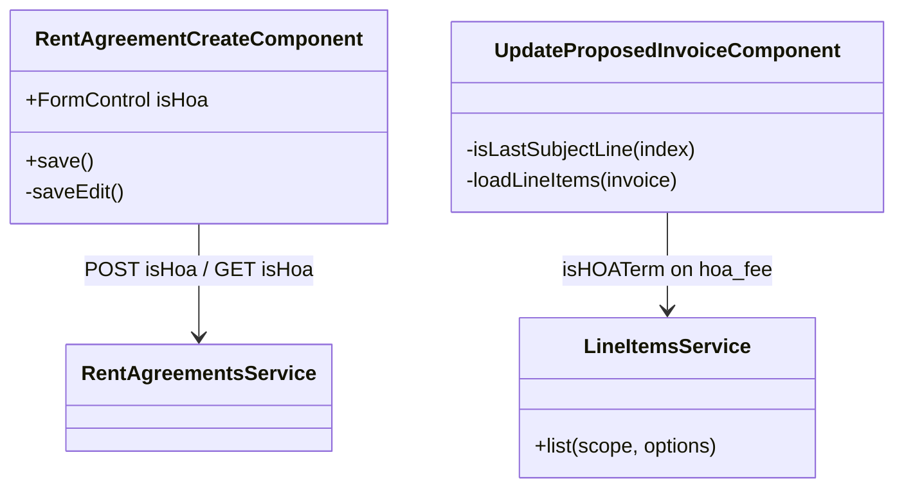

## Changelog

| Version | Date | Author | Summary | Plan |
|---------|------|--------|---------|------|
| v1 | 2026-10-14 | Abhishek Chaurasia | **Initial spec: HOA rent agreements in the test harness.** The client half of Billing spec `19-hoa-rent-agreements.md` **v2** (`docs/specs/hoa-rent-agreements/19-hoa-rent-agreements.md` in `innago-billing`, branch `abhishek/hoa-rent-agreement-scenarios`, commit `663b4fd2`). A tester can create an agreement as HOA, see it read back, see its invoices as *HOA Fee*, edit an HOA Fee invoice with the HOA Fee line protected like the rent line, and read the *"Changed from HOA Fee to Rent"* history entry a unit switch writes. Touches specs `01`, `03` and `08`; spec `04` already labels `hoa_fee` as *HOA Fee* and needs no change. | [2026-10-14T1900-12-hoa-rent-agreements-ui](../../plans/rent-agreements/2026-10-14T1900-12-hoa-rent-agreements-ui.md) |

## Overview

Billing can now bill a rent agreement as an **HOA agreement**: the property owner is a Homeowners
Association, and every recurring invoice is an **HOA Fee** invoice with an **HOA Fee** main line instead of
Rent (Billing spec 19, BR-01, BR-03). The flag is set when the agreement is created; the terms update
ignores it; afterwards only a *unit switch* event from the system that owns the unit changes it (Billing
BR-02, Flow 4).

This harness exercises that API (it is a test harness, not the product; wording here is not settled
product copy). Four screens are involved:

| Screen | Spec | What changes |
|---|---|---|
| Create / edit rent agreement | `01-rent-agreement-edit-ui.md` | An *HOA agreement* checkbox on create; shown read-only on edit and never resubmitted |
| Update proposed invoice | `03-update-proposed-invoice-ui.md` | On an HOA Fee invoice the HOA Fee line is the protected main line, and the line-item picker asks for the HOA catalog |
| Invoice activity timeline | `08-invoice-activity-timeline-ui.md` | The new entry type `InvoiceTypeChanged` is part of the model |
| Invoice list | `04-invoice-list-ui.md` | No change: `hoa_fee` already reads *HOA Fee* |

## Business Scope

A tester creates an agreement for an HOA, sees each month billed as an HOA Fee, and checks that the HOA
Fee line behaves like the rent line. Success, on Billing's worked example: create an agreement with *HOA
agreement* ticked and $250 a month; open it again and see the box ticked and disabled; activate it and see
`INV-…` invoices typed *HOA Fee* in the Invoices list; open *Correct* on one and find that removing the
HOA Fee line is refused, while removing a parking line is not. After a unit switch (sent by the owning
system, not by this harness), the invoice's activity timeline reads *"Changed from HOA Fee to Rent by the
system."*

## Functional Requirements

1. **Create — the checkbox.** The create form shall show an *HOA agreement* checkbox in the *Lease Dates*
   panel, below *Lease Term Type*, unticked by default.
2. **Create — the request.** `POST /api/v1/rent/agreements` shall carry `isHoa`: `true` when the box is
   ticked, `false` otherwise.
3. **Edit — read back.** Opening an existing agreement shall tick the box from `isHoa` in
   `GET /api/v1/rent/agreements/{id}` (`false` when the server omits it) and **disable** it, because the
   terms update cannot change it (Billing BR-02).
4. **Edit — never resubmitted.** `PUT /api/v1/rent/agreements/{id}/terms` shall not carry `isHoa`. (Billing
   ignores it if sent; leaving it out keeps the request honest about what the screen can change.)
5. **Update proposed invoice — the main line.** On an invoice whose `invoiceType` is `hoa_fee`, the line
   whose item type is `HOAFee` is the invoice's main line: removing the last such line shall be refused in
   the screen with *"An HOA Fee invoice must keep its HOA Fee line. Edit this one instead of removing
   it."*, as Billing refuses it with `RentLineMayNotBeRemoved` (Billing BR-06). On every other non-deposit
   invoice the main line stays `Rent`, with its existing message.
6. **Update proposed invoice — the catalog.** On an invoice whose `invoiceType` is `hoa_fee`, the line-item
   picker shall request `GET /api/v1/line-items?scope=AllExcludingCredit&isFromIncomeList=true&isHOATerm=true`,
   so the *HOA Fee* item is offered, as legacy offers it only on HOA terms. Every other invoice keeps the
   request it sends today (no `isHOATerm`).
7. **Timeline.** `InvoiceHistoryEntryType` shall include `InvoiceTypeChanged`; the entry renders its `text`
   as sent, like every other entry (spec 08).
8. **Invoice list.** No change: the list already shows `hoa_fee` as *HOA Fee* (spec 04).

## Constraints

- **Requires Billing spec 19 v2** (`innago-billing` branch `abhishek/hoa-rent-agreement-scenarios`). Against
  an older Billing, `isHoa` is ignored on create and absent on read (FR 3's `false`), and no invoice is
  `hoa_fee`, so FR 5 and FR 6 never apply.
- **The unit switch cannot be triggered from here.** It is an integration event
  (`PropertyUnitHoaStatusChangedIntegrationEvent`); this harness only shows its result (FR 7).
- **Type strings as Billing sends them:** `invoiceType` is snake_case (`hoa_fee`), a line's `itemType` is the
  member name (`HOAFee`), compared case-insensitively as the screen already does for `Rent`.

## Contract

### API Endpoints consumed

| Method | Route | Used for | Change |
|--------|-------|----------|--------|
| `POST` | `/api/v1/rent/agreements` | create | body gains `isHoa` (FR 2) |
| `GET` | `/api/v1/rent/agreements/{id}` | edit read-back | response carries `isHoa` (FR 3) |
| `PUT` | `/api/v1/rent/agreements/{id}/terms` | edit save | unchanged; `isHoa` not sent (FR 4) |
| `GET` | `/api/v1/invoices/{id}` | update proposed invoice | `invoiceType` may be `hoa_fee` (FR 5, 6) |
| `GET` | `/api/v1/line-items` | the picker | `isHOATerm=true` on an HOA Fee invoice (FR 6) |
| `GET` | `/api/v1/invoices/{id}/history` | timeline | entry `type` may be `InvoiceTypeChanged` (FR 7) |

### Input / Output models

| Type | Field | Notes |
|------|-------|-------|
| `CreateRentAgreementRequest` | `isHoa?: boolean` | FR 2 |
| `RentAgreementDetailResponse` | `isHoa?: boolean` | FR 3; optional because an older server omits it |
| `UpdateRentAgreementTermsRequest` | — | unchanged (FR 4) |
| `InvoiceHistoryEntryType` | `'InvoiceTypeChanged'` | FR 7 |

### Class Diagram

## Out of Scope

- Triggering a unit switch (Billing receives it as an event from the system that owns the unit).
- Product wording for HOA screens (Term, Owner, HOA Fee Updated): this is a test harness.
- The additional charge panel's catalog on the create screen: it already lists `HOAFee` under its scope.
- Notifications, reminders, QuickBooks and reports (Billing spec 19, Out of Scope).
